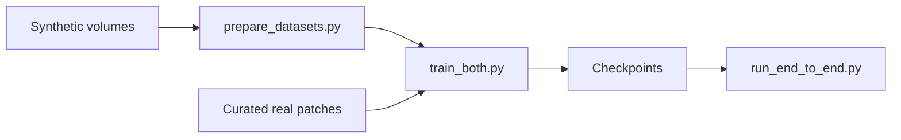
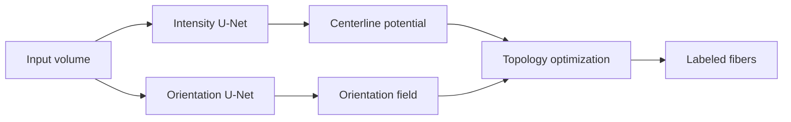

# Fiber Tracker

Fiber tracking of individual fibers in micro-CT volumes (so far only nonwoven scaffolds, more to come).

The pipeline combines two 3D U-Nets, which predict a centerline potential field and a fiber orientation field, with a graph-based topology optimizer that separates touching and crossing fibers into continuous, individually labeled instances.

**Input:** a 3D grayscale or binary volume (`.tif`, `.tiff` or `.npy`).
**Output:** a labeled instance volume and labeled centerlines (16-bit TIFF), optionally a GeoDict `.gad` fiber model.

---

## Contents

1. [Installation](#installation)
2. [Quick Start](#quick-start)
3. [Outputs](#outputs)
4. [Training Your Own Models](#training-your-own-models)
5. [Interactive Curation Tool](#interactive-curation-tool)
6. [Running Stages Individually](#running-stages-individually)
7. [How It Works](#how-it-works)
8. [Command-Line Reference](#command-line-reference)
9. [Project Structure](#project-structure)
10. [Testing](#testing)
11. [License](#license)
12. [References](#references)

---

## Installation

Requirements:

- Python 3.10 or newer
- An NVIDIA GPU with CUDA is strongly recommended (8 GB of VRAM or more). The pipeline also runs on CPU, but considerably slower.

For GPU support, install the PyTorch build that matches your CUDA version by following the instructions at [pytorch.org](https://pytorch.org/get-started/locally/) **before** running `pip install -r requirements.txt`.

Dependencies: PyTorch, NumPy, SciPy, scikit-image, tifffile, Matplotlib, tqdm, Flask and Flask-CORS.

---

## Quick Start

### 1. Provide model checkpoints

The pipeline needs two trained networks:

```
checkpoints/best_intensity_unet.pth
checkpoints/best_orientation_unet.pth
```

Checkpoints are not stored in the repository. Either copy existing checkpoints into `checkpoints/`, or train them yourself as described in [Training Your Own Models](#training-your-own-models).

### 2. Add your volume

Copy the volume to segment into `data/fibers_to_segment/`:

```
data/fibers_to_segment/my_sample.tif
```

Accepted formats are 3D `.tif` / `.tiff` stacks and `.npy` arrays, with axes ordered `(Z, Y, X)`. The volume should be 8-bit grayscale (0–255), binary, or floating point in the range 0–1. Convert 16-bit data to 8-bit beforehand (for example in Fiji with `Image > Type > 8-bit`).

### 3. Run the pipeline

```bash
python run_end_to_end.py
```

Without arguments, the script processes the first volume found in `data/fibers_to_segment/` and writes the results to `outputs/fiber_resolution_final/`. To choose the input and output explicitly:

```bash
python run_end_to_end.py --input data/fibers_to_segment/my_sample.tif --out outputs/my_sample
```

### 4. Inspect the results

Open `outputs/fiber_resolution_final/instance_volume.tif` in any of the following tools:

| Tool | How to view the instances |
| :--- | :--- |
| **Fiji / ImageJ** | `File > Open`, then `Image > Lookup Tables > glasbey_on_dark`. Use `Plugins > 3D Viewer` for a 3D rendering. |
| **napari** | `napari outputs/fiber_resolution_final/instance_volume.tif`, then convert the layer to a *Labels* layer. |
| **3D Slicer / Dragonfly** | Import the file as a label map / multi-label segmentation. |

Each fiber has its own integer value (1, 2, …, N); the background is 0.

---

## Outputs

`run_end_to_end.py` writes the following files to the output directory:

| File | Default | Description |
| :--- | :---: | :--- |
| `instance_volume.tif` | yes | 16-bit compressed TIFF. Every foreground voxel carries the ID of the fiber it belongs to. |
| `instance_skeleton.tif` | yes | 16-bit compressed TIFF. One-voxel-thick centerlines, labeled with the same IDs. |
| `fiber_length_histogram.png` | yes | Distribution of fiber centerline lengths. |
| `instance_fibers.gad` | `--export-gad` | GeoDict fiber model: ordered centerline points and local radii for each fiber. |
| `instance_volume.npy`, `instance_skeleton.npy` | `--export-npy` | Uncompressed `int32` NumPy arrays. Disabled by default because of their size. |

Example with optional exports:

```bash
# GeoDict model with a physical voxel size of 1 µm
python run_end_to_end.py --export-gad --gad-voxel-size 1e-06

# Also keep the NumPy arrays
python run_end_to_end.py --export-npy
```

---

## Training Your Own Models

Training uses synthetic fiber volumes with known geometry, optionally complemented by manually curated patches from real data.



### Step 1: Add synthetic data

Place pairs of synthetic volumes and their GeoDict fiber descriptions in `data/synthetic/raw/`. Each `.tif` file must have a `.gad` file with the same name:

```
data/synthetic/raw/AJ_model_01.tif
data/synthetic/raw/AJ_model_01.gad
data/synthetic/raw/AJ_model_02.tif
data/synthetic/raw/AJ_model_02.gad
```

Such volumes can be generated, for example, with the [Altendorf-Jeulin model](https://github.com/matthiasne/Altendorf-Jeulin-Model) or exported from GeoDict.

### Step 2: Precompute training targets

```bash
python prepare_datasets.py
```

This computes the target fields (centerline potential and orientation) for every model and splits them into `data/synthetic/precomputed/train/` and `data/synthetic/precomputed/test/` (90 % / 10 % by default, configurable with `--test-split`). With a single model, all data goes to training and validation is skipped.

### Step 3: Train both networks

```bash
python training/train_both.py
```

Defaults: 50 epochs, batch size 4, patches of 64³ voxels. The best weights are written to `checkpoints/best_intensity_unet.pth` and `checkpoints/best_orientation_unet.pth`.

Common variants:

```bash
# Continue from existing checkpoints
python training/train_both.py --pretrained

# Train only one of the networks
python training/train_both.py --mode intensity
python training/train_both.py --mode orientation

# Fine-tune on curated real patches only
python training/train_both.py --real-only --train-on-all-data --pretrained
```

If curated patches exist in `data/curated/`, they are automatically mixed into training (see the next section).

---

## Interactive Curation Tool

The curation tool is a browser-based 3D editor for correcting segmentations and creating ground-truth patches from real data. These patches improve the models on your specific material.

```bash
python curation_tool/app.py
```

Then open http://127.0.0.1:5000 in a browser. A different port can be set with the `PORT` environment variable.

### Basic workflow

1. Load a raw volume or a segmentation (for example `outputs/fiber_resolution_final/instance_volume.tif`) via the file dialog or by drag and drop.
2. A 96³ sub-volume is displayed with its automatically extracted centerlines.
3. Correct the centerlines: select a fiber, add or remove waypoints, and split falsely merged fibers.
4. Press `Space` to recompute the centerlines, then `Enter` to save the patch to `data/curated/patches/` and load the next one.

### Keyboard shortcuts

| Key | Action |
| :--- | :--- |
| `Space` | Recompute centerlines through the current waypoints |
| `Enter` | Save the current patch and load the next one |
| `R` | Load a new random sub-volume |
| `F` | Focus the camera on the selected fiber |
| `C` | Reset the crop to the full sub-volume |
| `V` / `M` | Switch between surface, point-cloud and skeleton display |
| `1` – `9` | Select the active fiber |

Axis colors in the 3D view: red = X, green = Y, cyan = Z.

### Extracting individual fibers for augmentation

Fibers from curated patches can be extracted individually and then inserted into synthetic training volumes:

```bash
python scripts/extract_individual_fibers.py --list          # show patches and their status
python scripts/extract_individual_fibers.py --patches 1 2 3 # extract from selected patches
python scripts/extract_individual_fibers.py --all           # extract from all patches
python scripts/extract_individual_fibers.py --remove 4      # remove fibers of one patch
```

Extracted fibers are stored in `data/curated/individual_fibers/`, and the fiber library `data/curated/fiber_library.pkl` is updated automatically.

### Iterative improvement

A typical refinement loop is:

1. Train an initial model on synthetic data.
2. Segment a real volume with `run_end_to_end.py`.
3. Open the result in the curation tool, correct the regions with errors and save them as patches.
4. Fine-tune with `python training/train_both.py --pretrained`.
5. Repeat from step 2.

---

## Running Stages Individually

`run_end_to_end.py` chains neural inference and topology optimization. Each stage can also be run on its own, which is useful for tuning the optimizer without repeating inference.

### Neural inference

```bash
python inference/run_inference.py --input data/fibers_to_segment/my_sample.tif --output-prefix outputs/my_sample
```

Produces:

- `outputs/my_sample_raw_probability.tif`: centerline potential, 16-bit TIFF (values 0–65535 correspond to 0–1).
- `outputs/my_sample_orientation_rgb.tif`: orientation field as an 8-bit RGB TIFF, with absolute X, Y, Z components mapped to R, G, B.

### Topology optimization

```bash
python inference/run_topology_optimization.py \
    --volume data/fibers_to_segment/my_sample.tif \
    --intensity outputs/my_sample_raw_probability.tif \
    --orientation outputs/my_sample_orientation_rgb.tif \
    --out outputs/my_sample_resolved
```

For very large volumes, the optimizer can process overlapping blocks:

```bash
python inference/run_topology_optimization.py --mode chunked --chunk-size 512 --overlap 256
```

To evaluate the result against a known ground truth, pass the reference `.gad` file with `--gad path/to/model.gad`.

### Border cleanup

Removes a margin from an existing result and relabels fibers that are cut by the new boundary:

```bash
python topology_optimizer/clean_border_artifacts.py --input outputs/my_sample_resolved --margin 32
```

---

## How It Works



### Neural fields

A binary foreground mask cannot separate fibers that touch, since they form a single connected component. Instead, two networks predict continuous fields:

- **Centerline potential** $I(x) \in [-1, 1]$. It is close to 1 on fiber centerlines, decays with distance from the centerline following a Gaussian profile, and becomes negative where two fibers touch. The negative values at contacts make adjacent fibers separable.
- **Orientation field** $O(x)$. A unit vector tangent to the fiber at every foreground voxel. Fibers are not directed, so $O$ and $-O$ describe the same direction.

The intensity network is trained with a foreground-weighted mean squared error combined with a soft Dice loss. The orientation network is trained with a sign-invariant cosine loss, $1 - |u \cdot v|$, weighted by the target potential.

Inference uses overlapping 64³ windows (stride 32) blended with Gaussian weights. Intermediate results are accumulated in memory-mapped files on disk, so volumes larger than the available RAM can be processed.

### Topology optimization

The two fields are converted into individual fibers in the following steps:

| Step | Operation |
| :--- | :--- |
| 1. Skeletonization | Threshold the smoothed potential (default 0.28) and thin it to one-voxel-wide centerlines. |
| 2. Border cut | Remove a margin (default 32 voxels) where predictions are less reliable. |
| 3. Junction severing | Cut short bridges between two fibers (see below). |
| 4. Fragment graph | Split the skeleton into unbranched fragments and estimate the direction at each end. |
| 5. Gap candidates | Search for fragment ends that could be connected across a gap (up to 24 voxels). |
| 6. Global matching | Select the set of connections with the lowest total cost. |
| 7. Length filter | Remove fibers shorter than `--min-fiber-length` (default 5 voxels). |
| 8. Label diffusion | Assign every foreground voxel to the nearest labeled centerline. |

**Junction severing.** When two fibers touch, skeletonization typically produces two branch points joined by a short transverse segment, an "H" shape. A branch is removed if it is short (at most 14 voxels) and approximately perpendicular to the fibers it connects:

```math
1 - \lvert \mathbf{d}_{\text{branch}} \cdot \mathbf{O}_{\text{fiber}} \rvert > 0.5
```

where $\mathbf{d}_{\text{branch}}$ is the unit direction of the branch.

**Endpoint directions.** The orientation at the very end of a fragment is often distorted. The direction used for matching is therefore averaged over several voxels inside the fragment.

**Global matching.** Each candidate connection $b$ between two fragment ends A and B receives a cost based on the gap length and on the alignment of their directions:

```math
c(b) = w_g \, d_{\text{gap}}(b) + w_\theta \arccos \lvert \mathbf{O}_A \cdot \mathbf{O}_B \rvert + P(b)
```

where $P(b)$ penalizes connections that are not supported by the orientation field along the gap. The optimizer selects connections that minimize the total cost under two constraints: each fragment end connects to at most one other end (fibers do not branch), and the resulting graph contains no cycles.

**Label diffusion.** Labels are propagated from the centerlines to the full fiber volume, restricted to the foreground. Connected components containing a single fiber are labeled directly; components containing several touching fibers are split with a local watershed.

### Training data augmentation

Synthetic volumes provide exact ground truth but do not look like real data. To reduce this gap, real fibers extracted from curated patches are deformed along synthetic fiber paths and inserted into the training volumes. The paths are additionally perturbed by random displacements, small oscillations, flips and rotations. The target fields for these augmented volumes are computed from the known paths.

---

## Command-Line Reference

### `run_end_to_end.py`

| Option | Default | Description |
| :--- | :--- | :--- |
| `--input` | first file in `data/fibers_to_segment/` | Input volume (`.tif`, `.tiff`, `.npy`) |
| `--out` | `outputs/fiber_resolution_final` | Output directory |
| `--intensity-ckpt` | `checkpoints/best_intensity_unet.pth` | Intensity network checkpoint |
| `--orientation-ckpt` | `checkpoints/best_orientation_unet.pth` | Orientation network checkpoint |
| `--patch-size` | `64` | Inference window size (voxels) |
| `--stride` | `32` | Inference window stride (voxels) |
| `--batch-size` | `4` | Inference batch size |
| `--chunk-size` | `32` | Number of slices written to disk at once |
| `--cut-border` | `32` | Border margin removed before optimization (voxels) |
| `--min-fiber-length` | `5` | Minimum fiber length (voxels) |
| `--export-gad` | off | Write a GeoDict `.gad` model |
| `--gad-voxel-size` | `1e-06` | Voxel size in meters for the `.gad` export |
| `--export-npy` | off | Also write `.npy` arrays |

### `inference/run_inference.py`

| Option | Default | Description |
| :--- | :--- | :--- |
| `--input` | first file in `data/fibers_to_segment/` | Input volume |
| `--output-prefix` | `outputs/fiber` | Prefix of the output files |
| `--mode` | `both` | `both`, `intensity` or `orientation` |
| `--intensity-only` / `--orientation-only` | off | Run a single network |
| `--intensity-ckpt`, `--orientation-ckpt` | `checkpoints/best_*.pth` | Checkpoints |
| `--patch-size`, `--stride`, `--batch-size` | `64`, `32`, `4` | Sliding-window settings |
| `--base-channels` | `32` | Network width (must match the checkpoint) |
| `--chunk-size` | `32` | Number of slices written to disk at once |
| `--export-npy` | off | Also write `float32` `.npy` fields |

### `inference/run_topology_optimization.py`

| Option | Default | Description |
| :--- | :--- | :--- |
| `--volume` | auto-detected | Raw or binary input volume |
| `--intensity` | auto-detected | Centerline potential (`.tif` or `.npy`) |
| `--orientation` | auto-detected | Orientation field (`.tif` or `.npy`) |
| `--out` | `outputs/topology_resolved` | Output directory |
| `--mode` | `direct` | `direct` (whole volume) or `chunked` |
| `--chunk-size`, `--overlap` | `512`, `256` | Block size and overlap in chunked mode |
| `--core-threshold` | `0.28` | Potential threshold for skeletonization |
| `--sigma-prefilter` | `0.60` | Gaussian smoothing before skeletonization |
| `--cut-border` | `32` | Border margin (voxels) |
| `--border-mode` | `crop` | `crop` (reduce volume size) or `zero` (keep size) |
| `--min-fiber-length` | `5` | Minimum fiber length (voxels) |
| `--gad` | none | Ground-truth `.gad` file for evaluation |
| `--export-gad`, `--gad-voxel-size` | off, `1e-06` | GeoDict export |
| `--export-npy` | off | Also write `.npy` arrays |

### `topology_optimizer/clean_border_artifacts.py`

| Option | Default | Description |
| :--- | :--- | :--- |
| `--input` / `--vol` | required | Instance volume file or result directory |
| `--skel` | none | Instance skeleton file |
| `--out` | derived from input | Output directory |
| `--margin` | `32` | Margin removed from each face (voxels) |
| `--min-size` | `1` | Minimum size of remaining fragments (voxels) |
| `--raw-vol`, `--intensity` | none | Optional volumes for preview images |
| `--no-previews` | off | Do not generate preview images |
| `--export-npy` | off | Also write `.npy` arrays |

### `prepare_datasets.py`

| Option | Default | Description |
| :--- | :--- | :--- |
| `--raw-dir` | `data/synthetic/raw` | Synthetic `.tif` + `.gad` pairs |
| `--train-dir` | `data/synthetic/precomputed/train` | Output for training data |
| `--test-dir` | `data/synthetic/precomputed/test` | Output for test data |
| `--test-split` | `0.10` | Fraction of models used for testing |
| `--overwrite` | off | Recompute existing targets |

### `training/train_both.py`

| Option | Default | Description |
| :--- | :--- | :--- |
| `--mode` | `both` | `both`, `intensity` or `orientation` |
| `--epochs` | `50` | Epochs per network |
| `--batch-size` | `4` | Batch size |
| `--grad-accum-steps` | `1` | Gradient accumulation steps |
| `--patch-size` | `64` | Training patch size (voxels) |
| `--samples-per-epoch` | `200` | Patches per epoch |
| `--base-channels` | `32` | Network width |
| `--lr` | `5e-4` | Learning rate |
| `--pretrained` | off | Start from the checkpoints in `checkpoints/` |
| `--pretrained-intensity`, `--pretrained-orientation` | none | Start from specific checkpoints |
| `--real-data-dir` | `data/curated` | Curated real data |
| `--real-stamp-prob` | `0.25` | Probability of inserting real fibers into a synthetic patch |
| `--real-repeat` | `3` | Weight of curated patches relative to synthetic data |
| `--real-only` | off | Train on curated patches only |
| `--train-on-all-data` | off | Use all curated patches for training (no validation split) |
| `--no-morph` | off | Disable fiber deformation augmentation |

### `scripts/extract_individual_fibers.py`

| Option | Default | Description |
| :--- | :--- | :--- |
| `--list` | off | List curated patches and their extraction status |
| `--patch ID` / `--patches ID ...` | none | Extract fibers from one or several patches |
| `--all` | off | Extract fibers from all patches |
| `--remove ID` | none | Remove the extracted fibers of a patch |
| `--clear` | off | Remove all extracted fibers |
| `--padding` | `2` | Margin around each extracted fiber (voxels) |
| `--curated-dir` | `data/curated/patches` | Curated patches directory |
| `--indiv-dir` | `data/curated/individual_fibers` | Output directory |
| `--library-cache` | `data/curated/fiber_library.pkl` | Fiber library file |
| `--no-sync-library` | off | Do not update the fiber library |

---

## Project Structure

```
fiber_segmentation_pipeline/
├── run_end_to_end.py          Full pipeline: inference and topology optimization
├── prepare_datasets.py        Target computation for synthetic training data
├── requirements.txt
│
├── core/                      Networks, losses, datasets, target generation, fiber deformation
├── inference/                 Sliding-window inference and topology optimization entry points
├── topology_optimizer/        Optimization steps, border cleanup, GeoDict export, evaluation
├── training/                  Training scripts
├── curation_tool/             Browser-based 3D curation tool
├── scripts/                   Fiber extraction and maintenance scripts
├── tests/                     Unit tests
│
├── checkpoints/               Trained weights (not tracked by git)
├── outputs/                   Results (not tracked by git)
└── data/                      Data (not tracked by git)
    ├── fibers_to_segment/     Volumes to segment
    ├── synthetic/
    │   ├── raw/               Synthetic .tif + .gad pairs
    │   └── precomputed/       Generated training and test targets
    └── curated/
        ├── patches/           Patches saved by the curation tool
        ├── individual_fibers/ Extracted real fibers
        └── fiber_library.pkl  Fiber library used for augmentation
```

---

## Testing

```bash
python -m unittest discover tests
```

---

## License

This project is released under the [MIT License](LICENSE).

Parts of this codebase were developed with the assistance of AI coding tools (Google Gemini).

## References
[1] X. Huang, D. Wen, Y. Zhao, Q. Wang, W. Zhou, D. Deng, 2016. Skeleton-based tracing of curved fibers from 3D X-ray microtomographic imaging. Results in Physics, 6, 170–177. [doi: 10.1016/j.rinp.2016.03.008](https://doi.org/10.1016/j.rinp.2016.03.008)

[2] A. Grießer, R. Westerteiger, E. Glatt, H. Hagen, A. Wiegmann, 2022. Identification and analysis of fibers in ultra-large micro-CT scans of nonwoven textiles using deep learning. The Journal of The Textile Institute, (11), 1647–1657. [doi: 10.1080/00405000.2022.2145429](https://doi.org/10.1080/00405000.2022.2145429)
